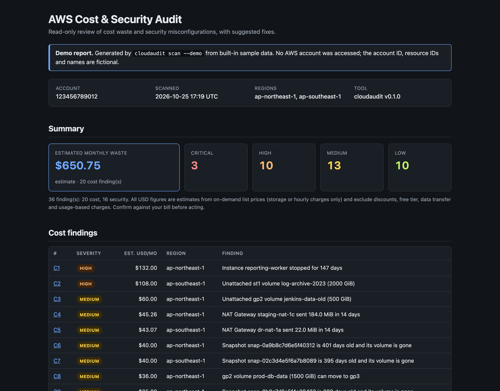
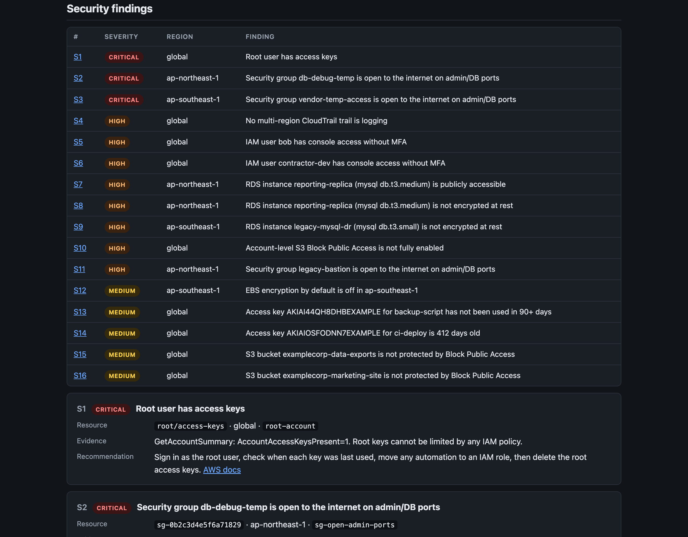

# cloudaudit: AWS cost & security review

cloudaudit is the tool behind a fixed-scope **AWS cost and security review**. With read-only access to your account, it finds money you are paying for and not using (idle NAT gateways, unattached volumes, forgotten snapshots) and the misconfigurations attackers look for first (databases open to the internet, IAM users without MFA, root access keys). You get a report with the evidence for each finding, an estimate of what it costs you per month, and the exact command to fix it. Nothing in your account is changed: fixes are suggestions you review and run yourself.



**See a full example:** [HTML report](examples/sample-report.html) · [Markdown report](examples/sample-report.md). Both were generated with `cloudaudit scan --demo` from a built-in fictional account, so you can see exactly what you would receive.

## What it checks

| ID | Category | What it finds | Typical fix |
|---|---|---|---|
| `ebs-unattached` | Cost | EBS volumes attached to nothing, still billed per GB | Final snapshot, delete |
| `ebs-gp2-to-gp3` | Cost | gp2 volumes; gp3 is ~20% cheaper per GB | `modify-volume --volume-type gp3` (online) |
| `ebs-snapshot-orphaned` | Cost | Snapshots older than 90 days whose volume is gone (skips AMI and AWS Backup snapshots) | Delete or archive |
| `eip-unassociated` | Cost | Elastic IPs not attached to anything | Release |
| `ec2-stopped` | Cost | Instances stopped 30+ days; their volumes are still billed | AMI backup, terminate |
| `nat-idle` | Cost | NAT Gateways with under 1 GiB of traffic in 14 days | Delete, release EIP |
| `elb-idle` | Cost | ALBs/NLBs with no healthy targets or almost no traffic in 14 days | Delete |
| `sg-open-admin-ports` | Security | `0.0.0.0/0` or `::/0` on SSH, RDP, MySQL, PostgreSQL, Redis, MongoDB, or all traffic | Exact `revoke-security-group-ingress` |
| `s3-public-access-block` | Security | Block Public Access not fully on at account level, and buckets it doesn't cover | `put-public-access-block` |
| `iam-user-no-mfa` | Security | IAM users who can sign in to the console without MFA | Assign MFA or remove the password |
| `iam-access-key-age` | Security | Active access keys older than 90 days or unused for 90 days | Rotate or deactivate |
| `root-account` | Security | Root user with access keys, or without MFA | Delete keys, enable MFA |
| `ebs-encryption-default` | Security | Regions where new EBS volumes are not encrypted by default | `enable-ebs-encryption-by-default` |
| `rds-unencrypted` | Security | RDS instances without encryption at rest | Snapshot, encrypted copy, restore |
| `rds-public` | Security | RDS instances with a public IP | `--no-publicly-accessible` |
| `cloudtrail-multi-region` | Security | No multi-region CloudTrail trail that is logging | Create a multi-region trail |



## How an engagement works

1. **You grant read-only access.** Deploy [`deploy/cloudformation/audit-role.yaml`](deploy/cloudformation/audit-role.yaml) with my account ID and an external ID we agree on. It creates one IAM role with AWS's `SecurityAudit` and `ViewOnlyAccess` policies plus the [exact list of calls](docs/iam-policy.json) cloudaudit makes. If you would rather not attach the managed policies, [`docs/iam-policy.json`](docs/iam-policy.json) is the minimal policy on its own.
2. **I run the scan** against every region you use:
   ```sh
   cloudaudit scan --role-arn arn:aws:iam::<your-account>:role/CloudAuditReadOnly \
     --external-id <agreed-id> --all-regions --format html --out report.html
   ```
3. **You get the report**: a single HTML file (prints cleanly to PDF) or Markdown, plus JSON if you want to feed it into other tools. Findings are sorted by money for cost and by severity for security, and each has its evidence, a recommendation and a fix command.
4. **We fix what matters.** We walk through the top items together; I apply the quick fixes you approve, or you run the commands yourself. When we're done, you delete the CloudFormation stack and my access is gone.

## Read-only, and provably so

- Every AWS call goes through the interfaces in [`internal/awsapi`](internal/awsapi/awsapi.go), which expose only `Describe*`, `Get*` and `List*` operations. The checks never see a full SDK client.
- [`TestInterfacesAreReadOnly`](internal/awsapi/readonly_test.go) reflects over every interface in that package and fails the build if any method name starts with `Create`, `Delete`, `Modify`, `Put`, `Update`, `Attach`, `Detach`, `Generate`, `Start`, `Stop` or `Terminate`. A companion test parses the package source, so a newly added interface cannot skip the check.
- [`TestIAMPolicyMatchesCode`](internal/awsapi/policy_test.go) derives the IAM actions from those interfaces and fails if the published policy or the CloudFormation role grants anything extra, uses a wildcard, or misses a call.
- IAM checks use per-user `List`/`Get` calls rather than `GenerateCredentialReport`, which would create a report object in your account.
- Fix commands are printed, never executed.

## Quick start

```sh
# Install (Go 1.26+), or download a binary from the Releases page
go install github.com/minhhieu21193/cloudaudit@latest

# Try it with no AWS account at all
cloudaudit scan --demo --format html --out demo.html

# Scan your own account with your current credentials
cloudaudit scan --profile my-profile --regions ap-northeast-1,ap-southeast-1 --format html --out report.html
```

### Demo mode

`cloudaudit scan --demo` runs all 16 checks against a built-in fictional company: production in Tokyo, a disaster-recovery setup in Singapore, and account-wide IAM, S3 and CloudTrail. It needs no credentials and never loads AWS configuration; it cannot be combined with `--profile` or `--role-arn`. All IDs are made up, and `123456789012` is the placeholder account ID AWS uses in its own documentation. Regenerate the committed examples with `make demo`.

### Options

| Flag | Default | Purpose |
|---|---|---|
| `--profile` | credential chain | AWS shared config profile |
| `--role-arn`, `--external-id` | | Assume the client's audit role |
| `--regions` / `--all-regions` | profile region | Regions to scan (comma-separated, or every enabled region) |
| `--checks` | all | Run only these check IDs (`cloudaudit checks` lists them) |
| `--format` | `md` | `md`, `html` or `json` |
| `--out` | stdout | Write the report to a file |
| `--min-severity` | `LOW` | Hide findings below this severity |
| `--fail-on` | `none` | Exit 2 if any finding is at or above this severity |
| `--snapshot-age-days`, `--stopped-days` | 90, 30 | Thresholds for the snapshot and stopped-instance checks |
| `--concurrency` | 4 | Regions scanned in parallel |

**Exit codes** (for CI): `0` no findings at or above `--fail-on`; `2` findings at or above `--fail-on`; `1` error. A partial scan, for example missing permission in one region, also exits `1`, but the report is still written and lists what failed.

## Limitations

- **Dollar figures are estimates.** They come from a static on-demand price table for five regions (us-east-1, us-west-2, eu-west-1, ap-northeast-1, ap-southeast-1) taken from the AWS Price List in October 2026; other regions use us-east-1 prices, and the report says so. They cover storage or hourly charges only, and exclude Savings Plans, Reserved Instances, EDP discounts, free tier, IOPS/throughput add-ons, LCUs and data transfer. Snapshot costs are an upper bound because snapshots are incremental.
- **Idle means quiet, not unused.** NAT and load-balancer checks look at 14 days of CloudWatch metrics; a DR or batch resource can be quiet on purpose. Every finding is a prompt to confirm with its owner.
- **Coverage is deliberately focused**: EC2/EBS, VPC, ELB, RDS, S3 account settings, IAM and CloudTrail. It does not cover Lambda, EKS, DynamoDB, bucket policies, KMS key policies, GuardDuty or Security Hub findings, or AWS Organizations-wide scanning.
- S3 bucket checks cover Block Public Access, not the content of bucket policies or ACLs.

## Development

```sh
make check     # go vet, go test, golangci-lint
make demo      # rebuild examples/sample-report.{html,md}
```

Each check lives in its own file under [`internal/rules`](internal/rules) with a table-driven test using the in-memory fakes in [`internal/fakeaws`](internal/fakeaws). CI runs vet, race-enabled tests, a demo smoke test and golangci-lint on every pull request; tagging `v*` builds Linux, macOS and Windows binaries (amd64 and arm64) with GoReleaser.
